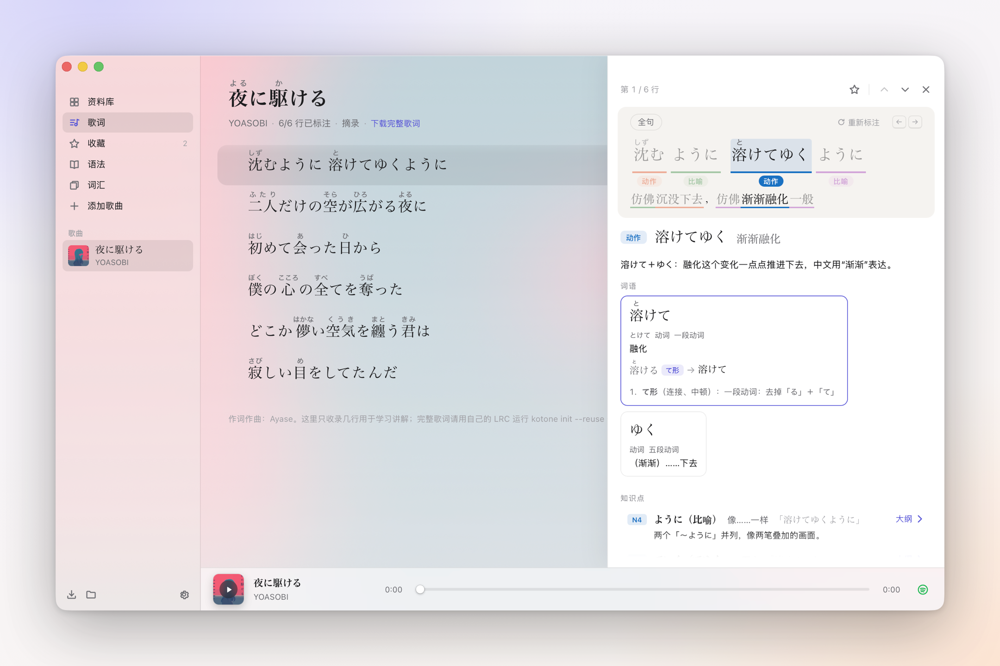
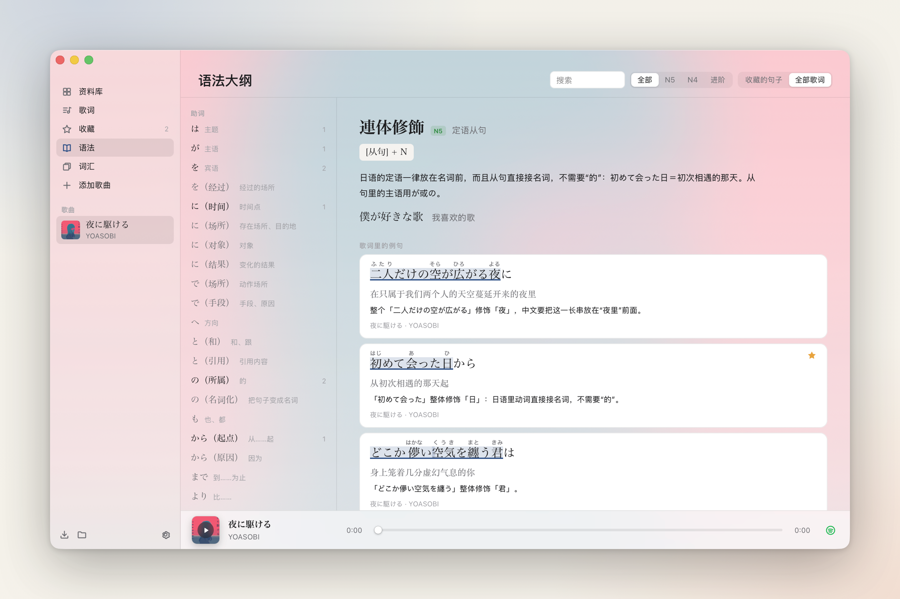
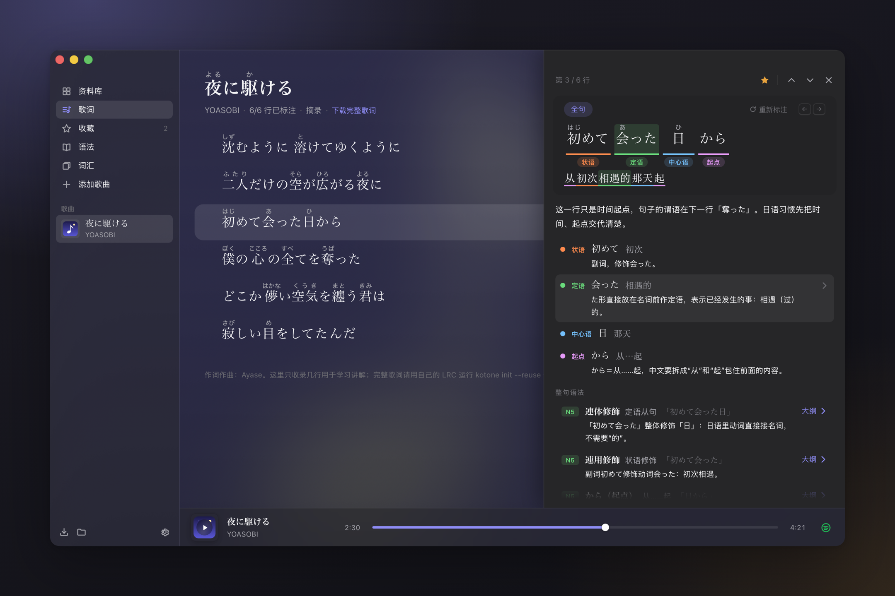

# Kotone 言音

**Learn Japanese through music.** A minimal macOS lyrics player for learning Japanese so you can **understand the songs you love**, built for Chinese-speaking learners at JLPT N5–N4.

- Lyrics come with **furigana** and a **Chinese translation side by side**, and the current line lights up as the song plays.
- Open any line for its breakdown, on demand:
  - its **phrases matched to the Chinese**, color by color;
  - how each word is **conjugated**, step by step from its dictionary form (the rules expand);
  - the **grammar points** it uses, explained for this line.
- **Save** lines. The **grammar outline** finds example lines for each grammar point among your saved lines (or all your lyrics), and **Words** organizes vocabulary and its uses by JLPT level.
- **Add a song** (sidebar, library or ⌘N) by searching Spotify's catalog.
  - Each result comes with lyrics, downloaded the way [LDDC](https://github.com/chenmozhijin/LDDC) does from NetEase Cloud Music, QQ Music, Kugou and LRCLIB.
  - Time-synced Japanese originals come first. **Platform translations are never used**: the Chinese is written only by the agent.
  - The lyrics, cover and Spotify track go into your library together, and Spotify plays it in the background.
  - It can also complete an existing song's lyrics and timing, keeping lines you've already annotated as they are.
- **Have Codex annotate songs right in the app.** Click "标注整首歌" (Annotate song) next to the title; it runs on your own ChatGPT plan. Each line appears in the lyrics as soon as it passes the checker, without leaving the player.
- The checking is deterministic. The app and the `kotone` CLI share one checker, which re-derives every reading, conjugation and Chinese correspondence the agent writes, and hands any mismatch back to the agent to fix.
- **A 550 KB download.** It uses the system WebView and bundles no browser engine.



| Grammar outline: from a grammar point to lines in your songs | Dark mode |
|---|---|
|  |  |

The UI is Solid inside a thin Swift shell: the system's WKWebView, your Spotify app for playback (or AVPlayer for a local file), URLSession for downloading lyrics, and your Codex for annotating. No browser engine is bundled, so the whole app is about 1 MB.

The interface comes in Chinese and English (Settings → Language; it follows the system by default, and so does the menu bar). Translations, notes and the grammar outline are written for Chinese speakers and stay in Chinese whichever interface language you pick.

## Download

Get `Kotone-<version>.zip` (about 550 KB) or the `.dmg` from [Releases](https://github.com/typedgrammar/kotone/releases/latest), and move Kotone into Applications. It's signed with a Developer ID and notarized by Apple, so it opens with a double-click. Needs macOS 13 or later on Apple silicon.

- Playback goes through the Spotify desktop app (see "Playing with Spotify"). The first time you play, macOS asks whether Kotone may control Spotify.
- Annotating in the app needs the [Codex](https://github.com/openai/codex) CLI installed and signed in (see "Annotating with Codex in the app").

## Building from source

Needs Node ≥ 22.18 (it runs TypeScript directly), pnpm and the Xcode Command Line Tools (`swiftc`).

```sh
pnpm install
pnpm app          # build the web UI and the Swift shell → build/Kotone.app, and open it
pnpm dev          # the UI alone in a browser (http://localhost:5173), on the same library
pnpm test         # conjugation engine, furigana, checker and CLI tests
macos/release.sh  # a release: arm64, Developer ID signed and notarized, zip and dmg (--publish to GitHub Releases)
```

The bundled demo is a **6-line excerpt** of YOASOBI's 夜に駆ける. The lyrics are copyrighted, so the repo doesn't carry them in full.

- Click "下载完整歌词" (Get full lyrics) under the title, pick a result, then "补全《夜に駆ける》" (Complete it). You get the full time-synced original, and the annotated lines still open into their breakdowns.
- Then click "标注整首歌" (Annotate song) and watch the rest fill in as you listen (see the next section).
- With the Spotify desktop app installed, click the cover at the bottom left to play (see "Playing with Spotify"). Without it, use "关联音频文件…" (Link audio file) to pick your own audio.

## Playing with Spotify

Like LyricsX, SpotMenu and other open-source clients, Kotone uses your Spotify desktop app as its player. Everything happens in Kotone; Spotify never comes to the front.

- **Finding the track.** Kotone opens Spotify's own web search in a hidden WebView and reads the tracks from the page's API responses (no developer account needed).
  - A track is used only when both title and artist match, and originals win over THE FIRST TAKE, covers and the like.
  - The track is remembered in the library's `state.json`, so next time it plays at once. It's looked up as soon as you open a song.
- **Playback and position.**
  - AppleScript plays, pauses and seeks; ▶ in front of a line starts from that line.
  - Kotone follows Spotify's playback notifications and reads the position every 1.5 seconds, so the lyrics highlight and scroll to the middle in time.
  - If Spotify isn't running, it's started hidden.
- **Following along.** Switch to a song from your library in Spotify (or from your phone), and Kotone switches with it.
- The first time you play, macOS asks whether Kotone may control Spotify (System Settings › Privacy & Security › Automation). Songs that aren't on Spotify can still use a local audio file.

Keys: `Space` play/pause · `↑/↓` (`j/k`) step through the breakdowns line by line · `Esc` close · `F` furigana · `T` translation.

## Annotating with Codex in the app

The app runs your own `codex app-server` in the background (the JSON-RPC interface of the [Codex CLI](https://github.com/openai/codex)), so it uses your own ChatGPT sign-in, plan quota and models. Everything about Codex is in Settings (⌘, or the gear at the bottom of the sidebar):

- whether it's available (version, account, this week's quota);
- signing in with ChatGPT;
- the path to Codex (by default it's found on your shell's PATH);
- Fast mode.

If you don't have Codex yet, `npm i -g @openai/codex`.

Codex gets the annotation spec, the song's original text and three tools the app registers, and nothing else:

- a read-only sandbox, with no commands approved and web search off;
- its built-in coding system prompt replaced by a one-sentence annotator brief;
- your global hooks, plugins, memory, shell and so on switched off for the session (they don't help annotating and slow every step down).

| Tool | What it does |
|---|---|
| `submit_lines` | Submits complete annotations for several lines at once. The app checks each line on the spot with the same rules as `kotone check`: lines that pass are saved and shown immediately; for the rest the errors go back to Codex, which fixes them and resubmits |
| `conj` | Derives a conjugation (like `kotone conj`) |
| `grammar_search` | Looks up grammar point ids (like `kotone grammar`) |

Sessions run in parallel, each submitting its whole batch at once (`submit_lines`):

- Up to 8 sessions, each with about ⌈lines/8⌉ lines, so 49 lines means 8 sessions of 7.
- Reasoning effort is fixed at `medium`, whatever your global config says: `xhigh` measured more than twice as slow, with no difference in quality under the checker.
- Fast mode (Codex's Fast service tier, about 1.6× faster) is on by default and can be turned off in Settings.
- In the app, 8 lines took about 35 seconds and 24 lines about 40.
- A line that fails twice is skipped and listed, and you can click "停止" (Stop) at any time.

The translation can only be written by Codex itself (see "Lyrics download").

The protocol client is `core/codex.ts` and the annotation loop `core/annotator.ts`, both testable without the UI. `macos/Sources/Agent.swift` only starts the process and passes each line of JSON along.

## Annotating with an external agent (CLI)

Without the app, or with another agent, the same flow runs from the CLI:

```sh
alias kotone="node $PWD/cli/kotone.ts"

kotone lyrics 夜に駆ける YOASOBI             # search four sources and list lyric refs
kotone init netease:1409311773 --id yoru-ni-kakeru \
  --reuse songs/yoru-ni-kakeru/song.json     # download the original into a skeleton (zh empty); --reuse keeps lines already annotated
kotone prompt yoru-ni-kakeru.song.json      # the task brief for the agent
# …the agent fills in each line following `kotone spec`, running check until it reports 0 errors…
kotone add yoru-ni-kakeru.song.json --audio ~/Music/夜に駆ける.m4a
```

- `init` also takes your own LRC or plain-text file. In bilingual LRCs exported by LDDC, the translation and romaji lines that share a timestamp with the original are dropped.
- Switch back to the app and the song is in the library.
- Songs added in the app with "Add Song" are already in the library: run `kotone prompt <song id>` directly (`status`, `check` and `times` take library ids too).

The repo comes with a Claude Code skill ([`.claude/skills/annotate-lyrics`](.claude/skills/annotate-lyrics/SKILL.md)): in this directory, ask Claude to finish annotating 夜に駆ける.

| Command | What it does |
|---|---|
| `spec` | Prints the full annotation spec for the agent ([docs/annotation-guide.md](docs/annotation-guide.md), the conjugation steps table and the grammar point ids) |
| `lyrics <keywords>` / `lyrics <ref> [-o x.lrc]` | Search lyrics / download an original LRC (see "Lyrics download") |
| `init` / `status` / `prompt` | Make a skeleton (from a file or a lyric ref), show progress, write the task brief |
| `check [--json] [--strict]` | Check (see below) |
| `conj 奪う:うばう godan Passive Ta` | Derive a conjugation and explain each step, for the agent to check itself |
| `grammar [keyword\|id]` / `ruby 初めて はじめて` | Look up the grammar outline / preview how furigana splits |
| `times <song.json> <lrc> --write` | Merge an LRC's timing into existing annotations, matching by text |
| `add` / `library` | Import into / list the app's library (`~/Library/Application Support/Kotone`, or `KOTONE_HOME`) |

`check` verifies that:

- the tokens spell out the original line exactly;
- readings are kana only, and agree with the kana in each word (which also works out how the furigana splits);
- each verb's and adjective's `lemma + class + steps` **derives** both the form and the reading it has in the lyrics;
- each phrase's Chinese really appears in the translation;
- grammar point ids exist (a typo gets the closest matches).

For example:

```
✗ L03 tokens[4]「呼んだ」 读音「よんた」和「呼んだ」里的假名对不上
✗ L03 tokens[4]「呼んだ」 呼ぶ(ichidan) +Ta：一段动词的辞书形以「る」结尾
✗ L03 grammar[1] verb-ta-form 未知的语法点 id，是不是：verb-ta / verb-tara / verb-tari
```

## Lyrics download

The same sources [LDDC](https://github.com/chenmozhijin/LDDC) supports, reimplemented in TypeScript in `core/lyrics/` (none of LDDC's GPL code is copied) and shared by the CLI and the app:

| Source | Search | Lyrics |
|---|---|---|
| NetEase Cloud Music | Public web API (no eapi encryption needed) | Only the original LRC (`lv`, not `tv`) |
| QQ Music | musicu.fcg (anonymous session); falls back to search suggestions when rate-limited | `trans: 0`; with QRC off it returns plain LRC, no 3DES decryption needed |
| Kugou | Lyric candidates by file hash | KRC (XOR + zlib), ignoring its `[language:]` translation/romaji tag |
| LRCLIB | Open API | LRC |

**Translations come only from the agent.**

- The download path never requests, parses or stores any platform's translation, and the downloaded data has no field for one.
- Skeletons from `init` or from completing a song always have empty `zh`; only reused, already-annotated lines carry the `zh` an agent wrote earlier.
- Translation lines in bilingual LRCs are dropped.
- Only the line timing and the original text are kept. Credit lines ("作词：…") and a leading "title - artist" are moved into `source`. Word-by-word (karaoke) timing isn't used yet.

**Covers** are downloaded with the lyrics (`core/lyrics/cover.ts`) and stored in the library as `songs/<id>/cover.jpg`.

- Lyrics from NetEase use that song's album art. Otherwise Kotone asks the iTunes Store (the official cover, 800 px), then falls back to a NetEase search.
- A search result is used only if its title matches; otherwise a placeholder stays, never another song's cover.
- Songs downloaded before this get theirs once, at launch.
- Covers show on the library's cover wall, as sidebar thumbnails and, blurred, behind the lyrics.

These APIs need request headers a browser page can't send, so in the app the requests go out through Swift's URLSession (only to these hosts and the cover image hosts, through the system proxy); under `pnpm dev` the dev server proxies them. The CLI honours `https_proxy` and the like. These are all unofficial APIs that can change at any time; when a source fails, the UI shows why under that source, and the others carry on.

## Data format

A song is one JSON file (types in [core/types.ts](core/types.ts), the full description in the [annotation guide](docs/annotation-guide.md)). A line looks roughly like this:

```jsonc
{
  "id": "L03", "time": 47.2,
  "ja": "初めて会った日から",
  "zh": "从初次相遇的那天起",
  "tokens": [
    { "text": "初めて", "reading": "はじめて", "pos": "adverb", "gloss": "初次" },
    { "text": "会った", "reading": "あった", "pos": "verb", "gloss": "相遇",
      "lemma": { "text": "会う", "reading": "あう", "class": "godan" }, "steps": ["Ta"] },
    { "text": "日", "reading": "ひ", "pos": "noun", "gloss": "那天" },
    { "text": "から", "pos": "particle", "gloss": "从……起" }
  ],
  "chunks": [   // phrases ↔ pieces of the Chinese (the same color in the UI)
    { "ja": "会った", "zh": "相遇的", "role": "定语", "note": "た形直接修饰名词…" },
    { "ja": "から", "zh": ["从", "起"], "role": "起点" }
  ],
  "grammar": [  // points in the grammar outline; conjugation points come from steps automatically
    { "id": "relative-clause", "ja": "初めて会った日", "note": "「初めて会った」整体修饰「日」…" }
  ],
  "note": "这一行只是时间起点，谓语在下一行「奪った」。"
}
```

Furigana isn't annotated separately: it's aligned from `text` and `reading` (`初めて/はじめて → 初(はじ)めて`), with a hand-written `ruby` only where they can't be aligned, as with jukujikun.

## Layout

```
core/      Shared TypeScript: the conjugation engine, furigana alignment, grammar outline, per-line analysis and
           checking, cross-song indexes, lyrics download (one copy for the CLI and the UI)
cli/       The kotone CLI (Node runs the .ts directly, no build step)
web/       The Solid UI, styled entirely with Tailwind v4 utilities: design tokens (colors, fonts, animations) in
           styles.css's @theme, light and dark following the system; class strings used in several places live
           in ui.ts (ready for a future native version to reuse); bridge.ts goes through the native bridge in
           WKWebView and falls back to <audio> + localStorage + the dev server in a browser
macos/     The Swift shell (build.sh makes the .app with swiftc, no Xcode project): window and vibrancy, the
           kotone:// scheme, the JS bridge, Spotify control and hidden search, AVPlayer/Now Playing, library
           storage, lyrics requests, the codex app-server process; release.sh signs and notarizes releases
songs/     The demo annotation bundled with the app
docs/      The annotation guide (also the text of `kotone spec`) and the README's screenshots
promo/     The promo video and the README's screenshots, made from the live app
```

The CLI and the app share `core/analyze.ts`: an annotation that passes `check` renders in the app exactly the same way.

## Copyright

The repo contains only the few lines of 夜に駆ける (words and music by Ayase) used for the demo. Downloaded lyrics and covers belong to their owners and stay in your local library, for personal study; please don't commit lyrics from your library or distribute them. For local audio, use files you obtained legally.

## License

The code is [MIT](LICENSE) licensed. That doesn't cover the lyrics, covers or audio described under "Copyright".
